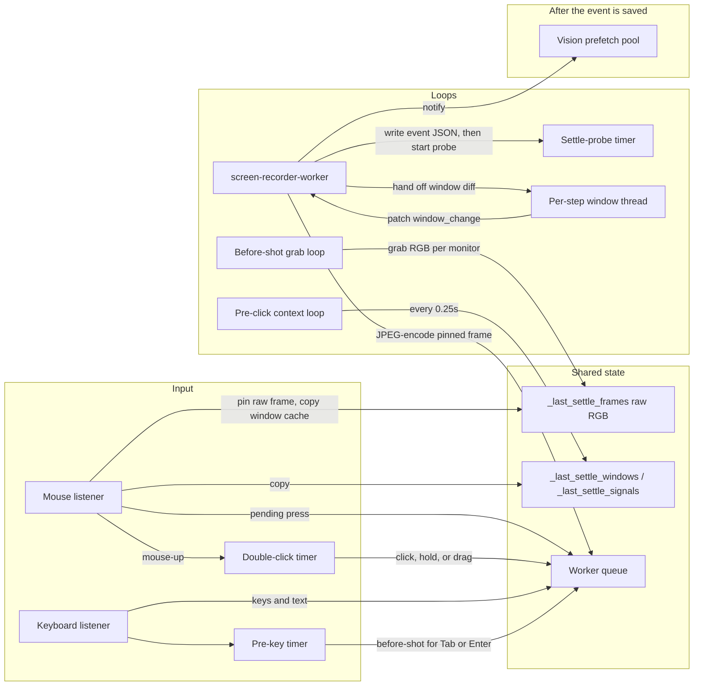

# Recording loops

What runs while a session is being recorded, and how a click moves between them. All of this lives in `src/recorder/capture.py` unless noted.

## Threads

## Shared state

| Name | Written by | Read by |
| --- | --- | --- |
| `_last_settle_frame` | Settle-probe timer, when a sample is published | Mouse hook, which pins it as the next step's screenshot |
| `_last_settle_windows`, `_last_settle_signals` | Pre-click context loop | Mouse hook, copied at press time and stored with that click |
| Worker queue | Mouse hook, keyboard hook, both timers | `screen-recorder-worker`, one job at a time |
| `_settle_probe` | Worker, immediately after the event JSON is written | Settle-probe timer. A start replaces the slot only when its event index is newer |

## Loops

### Before-shot grab loop

Thread `screen-recorder-before-shot`. Round-robins each physical monitor with a long-lived `mss` instance and stores raw RGB in `_last_settle_frames` (no JPEG in this loop). Mouse-down pins that monitor's latest raw frame. The worker JPEG-encodes the pinned frame when adopting it into `_pending_capture_*.jpeg` / `event_N.jpeg`, and refreshes durable `_last_settle_frame.jpeg` only then.

### Settle-probe timer

One slot. After each recorded click, drag, hold, text input, or key press, the worker replaces that slot without waiting for an in-flight tick: the timer is cancelled, the new probe starts, and a superseded tick no-ops before it publishes.

The first sample is immediate. Later samples wait `_SETTLE_PROBE_INTERVAL_S` (1.0s), up to 55 seconds. The first similar pair records `observed_settle_seconds` but does not stop the probe; sampling continues until the next event replaces the slot (or the max window). Settle samples measure stability only; they do not publish before-shots. The probe timer does not enumerate windows. The context loop owns that cache.

### Pre-click context loop

Thread `screen-recorder-preclick-context`. Every 0.25 seconds (`_PRE_CLICK_CONTEXT_INTERVAL_S`) it refreshes the window list and the fast signals. Clipboard and UI Automation are refreshed at most once a second on this same thread, so a stall here does not block the probe timer.

The mouse hook copies this cache at press time. It does not enumerate windows itself.

### screen-recorder-worker

Thread `screen-recorder-worker`. One queue, one job at a time. The first job seeds the window list so the context loop can start.

For a click the queue holds two jobs: `pending_left_press` (JPEG-encode the pinned raw before-shot into `_pending_capture_{press_seq}.jpeg`) and, after mouse-up, the emitted click. Persisting that click writes the event JSON, notifies the hub, and starts the settle probe. It does not sleep and it does not call UI Automation.

Each press has its own pending file so two presses cannot share `_pending_capture.jpeg`.

### Per-step window thread

After the event file exists, the worker starts `window-step-N`. That thread sleeps only the remainder of the settle delay measured from the gesture: 0.25 seconds normally, 0.45 seconds for a title-bar click. It then enumerates windows and runs UI Automation with a 1 second timeout. On timeout it leaves `window_change` empty. Otherwise it patches `window_change`, `target_window_title`, and `window_snapshot_debug` into the event JSON.

`finalize_stop` joins these threads for up to 2 seconds before it writes `session.json`. A slow step stays on its own thread, so the next click's probe can start while this one is still in UI Automation. A late thread cannot replace a newer probe, because `_start_settle_probe` ignores an event index that is not newer than the probe already running.

### Vision prefetch pool

`recording-vision-prefetch` in `src/recorder/vision_prefetch.py`. The hub's `_on_recording_event` enqueues the saved event. YOLO and OCR run here and do not block the worker. In the 05:52 session, step 1's prefetch was still running when step 4's probe started.

### One-shot timers

These are not loops. They are how input reaches the worker.

| Timer | Delay | What it does |
| --- | --- | --- |
| Double-click | Up to 0.35 seconds after mouse-down | Mouse-up schedules it. It then enqueues the click, or a hold or drag. A second press at the same spot emits a double-click instead. |
| Pre-key | 0.3 seconds after typing pauses | Enqueues a before-shot so the next Tab or Enter can reuse a settled frame. The low-level hook cannot grab the screen before that key is delivered. |
| Clipboard | Join 0.25 seconds | A short thread inside a signal refresh. If the clipboard owner blocks, the caller continues without text. |

### Stop

`_finish_settle_against_final_after` replaces the probe timer. It captures the full desktop until the sample matches `final_after.jpeg` or 55 seconds pass.
