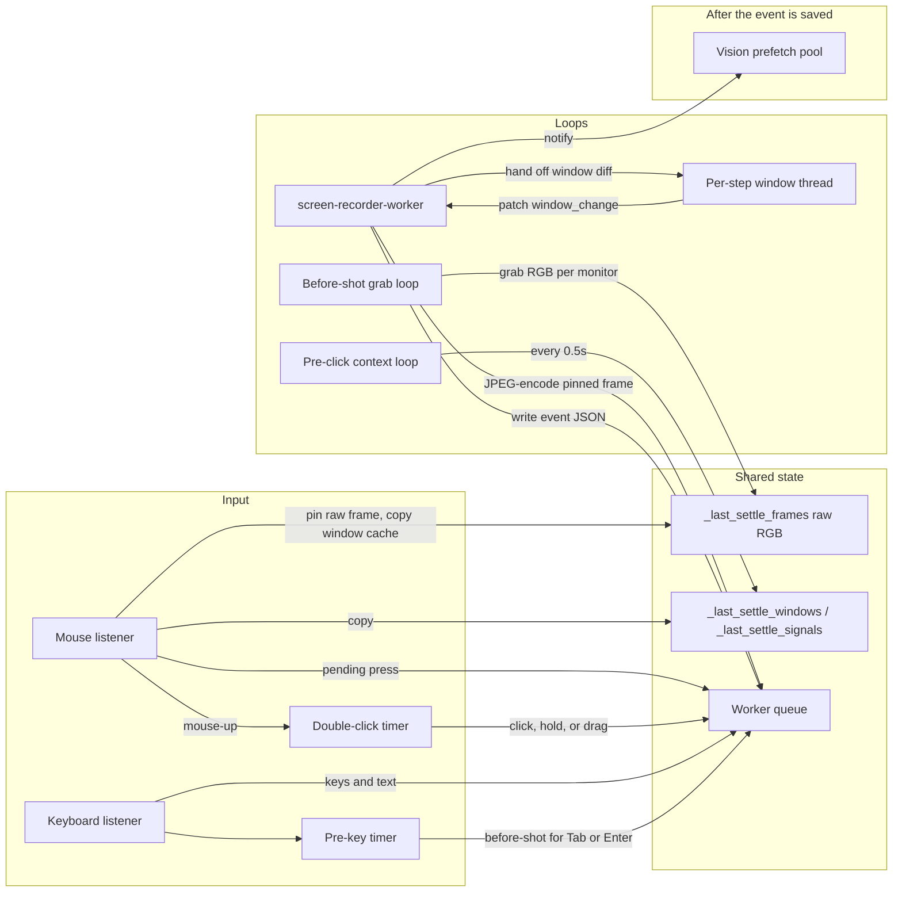

# Recording loops

What runs while a session is being recorded, and how a click moves between them. All of this lives in `src/recorder/capture.py` unless noted.

## Threads

## Shared state

| Name | Written by | Read by |
| --- | --- | --- |
| `_last_settle_frames` | Before-shot grab loop | Mouse hook, which pins a monitor's latest raw frame as the next step's screenshot |
| `_last_settle_windows`, `_last_settle_signals` | Pre-click context loop | Mouse hook, copied at press time and stored with that click |
| Worker queue | Mouse hook, keyboard hook, both timers | `screen-recorder-worker`, one job at a time |

> **Note:** budgeted FindAll settle/hover/seed caches (`_last_settle_uia*`) are removed for new format. Press identity is ElementFromPoint + `parents` only.

## Loops

### Before-shot grab loop

Thread `screen-recorder-before-shot`. Round-robins each physical monitor with a long-lived `mss` instance and stores raw RGB in `_last_settle_frames` (no JPEG in this loop). Paces at `_BEFORE_SHOT_INTERVAL_S` (0.5s) after each monitor grab. Mouse-down pins that monitor's latest raw frame. The worker JPEG-encodes the pinned frame when adopting it into `_pending_capture_*.jpeg` / `event_N.jpeg`, and refreshes durable `_last_settle_frame.jpeg` only then.

### Pre-click context loop

Thread `screen-recorder-preclick-context`. Every 0.5 seconds (`_PRE_CLICK_CONTEXT_INTERVAL_S`) it refreshes the window list and the fast signals. Clipboard and UI Automation are refreshed at most once a second on this same thread, so a stall here does not block the before-shot loop.

The mouse hook copies this cache at press time. It does not enumerate windows itself.

### screen-recorder-worker

Thread `screen-recorder-worker`. One queue, one job at a time. The first job seeds the window list so the context loop can start.

For a click the queue holds two jobs: `pending_left_press` (JPEG-encode the pinned raw before-shot into `_pending_capture_{press_seq}.jpeg`) and, after mouse-up, the emitted click. Persisting that click writes the event JSON, notifies the hub, and starts the window-step thread. It does not sleep and it does not call UI Automation.

Each press has its own pending file so two presses cannot share `_pending_capture.jpeg`.

### Per-step window thread

After the event file exists, the worker starts `window-step-N`. That thread sleeps only the remainder of the settle delay measured from the gesture: 0.25 seconds normally, 0.45 seconds for a title-bar click. It then enumerates windows and runs light UI Automation signals with a 1 second timeout. On timeout it leaves `window_change` empty. Otherwise it patches `window_change`, `target_window_title`, and `window_snapshot_debug` into the event JSON.

**No budgeted FindAll** runs on this thread for new format (seed / settle / typing / hover / press-miss FindAll publishers removed). Useful `uia_snapshot` / `end_uia_snapshot` are not attached from FindAll.

### Idle hover EFP (no FindAll warm)

The ~0.45s idle debounce drives ElementFromPoint Name/Value/`parents` for the LED preview and optional latched idle payload used at press. It does **not** run a budgeted ControlView / FindAll walk.

### Recording UIA status LED

While recording, an always-on-top strip (`RecordingUiaStatusOverlay`) shows:

| Signal | Meaning |
| --- | --- |
| Red | No usable labeled EFP leaf under the cursor |
| Green | Idle / press EFP is a usable labeled leaf (`data_item`, `button`, `tab_item`, … with landmark label + bbox) |
| Name \| Value (+ compact parent) | Idle `ElementFromPoint` after ~0.45s without mouse move — live preview (not written until press). Compact parent comes from the first usable node in `parents[]`. |

The strip is click-through and, on a normal local desktop, uses `WDA_EXCLUDEFROMCAPTURE` so it should not appear in recording screenshots. That affinity is skipped for RDP / Hyper-V Enhanced Session and detected VM guests; set `CUA_UIA_STATUS_EXCLUDE_FROM_CAPTURE=0` to force the same. It stays top-center by default and relocates when the cursor overlaps it.

### EFP identity + YOLO nearby

Cache `move_mouse` identity for new format:

- **Hub:** press-time EFP → analysis primary `source=uia_efp` → compile `hub_source=uia_efp` with `name` / `value` / `parents`.
- **Nearby / `landmark_geometry`:** YOLO+OCR peers only (never FindAll texts).
- Pure YOLO+OCR steps omit `hub_source` (no alternate UIA hub type; never `findall`).

Recording may prefer a **latched idle hover EFP** (probed near the press xy after ~0.45s idle) when the worker’s live press EFP Name/Value differs — for example Word File tab → Backstage `返回` at the same point after the click. Proximity (≤12px) is the freshness gate.

### Cache replay (summary)

Replay UIA-first uses constellation-EFP against YOLO landmarks, then ancestor-scoped Name lookup (`find_uia_leaf_by_efp_path`) with full `parents_chains_agree` before commit. Soft-miss falls through to the YOLO twin. There is no budgeted window FindAll walk and no live FindAll YOLO→UIA repair. Details: [`docs/replay-flow.md`](docs/replay-flow.md).

`finalize_stop` joins window-step threads for up to 2 seconds before it writes `session.json`. A slow step stays on its own thread, so the next click's window-step can start while this one is still in UI Automation.

### Vision prefetch pool

`recording-vision-prefetch` in `src/recorder/vision_prefetch.py`. The hub's `_on_recording_event` enqueues the saved event. YOLO and OCR run here and do not block the worker. In the 05:52 session, step 1's prefetch was still running when step 4's window-step started.

### One-shot timers

These are not loops. They are how input reaches the worker.

| Timer | Delay | What it does |
| --- | --- | --- |
| Double-click | Up to 0.35 seconds after mouse-down | Mouse-up schedules it. It then enqueues the click, or a hold or drag. A second press at the same spot emits a double-click via ``emit_left_gesture`` reusing the first press (same UIA attach rules as click), not ``mouse_pointer_event``. |
| Pre-key | 0.3 seconds after typing pauses | Enqueues a before-shot so the next Tab or Enter can reuse a settled frame. The low-level hook cannot grab the screen before that key is delivered. |
| Clipboard | Join 0.25 seconds | A short thread inside a signal refresh. If the clipboard owner blocks, the caller continues without text. |

### Stop

`finalize_stop` seals the last event's after-cache, captures `final_after.jpeg`, writes `session.json`, and joins in-flight window-step threads.
