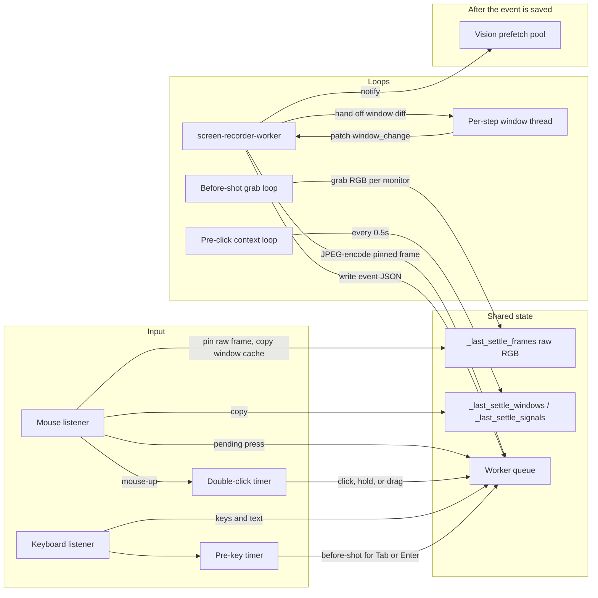

# Recording loops

What runs while a session is being recorded, and how a click moves between them. All of this lives in `src/recorder/capture.py` unless noted.

## Threads

## Shared state

| Name | Written by | Read by |
| --- | --- | --- |
| `_last_settle_frames` | Before-shot grab loop | Mouse hook, which pins a monitor's latest raw frame as the next step's screenshot |
| `_last_settle_windows`, `_last_settle_signals` | Pre-click context loop | Mouse hook, copied at press time and stored with that click |
| `_last_settle_uia` | Window-step after settle (and recording seed) | Mouse hook, copied at press as `uia_snapshot` when hwnd matches |
| Worker queue | Mouse hook, keyboard hook, both timers | `screen-recorder-worker`, one job at a time |

## Loops

### Before-shot grab loop

Thread `screen-recorder-before-shot`. Round-robins each physical monitor with a long-lived `mss` instance and stores raw RGB in `_last_settle_frames` (no JPEG in this loop). Paces at `_BEFORE_SHOT_INTERVAL_S` (0.5s) after each monitor grab. Mouse-down pins that monitor's latest raw frame. The worker JPEG-encodes the pinned frame when adopting it into `_pending_capture_*.jpeg` / `event_N.jpeg`, and refreshes durable `_last_settle_frame.jpeg` only then.

### Pre-click context loop

Thread `screen-recorder-preclick-context`. Every 0.5 seconds (`_PRE_CLICK_CONTEXT_INTERVAL_S`) it refreshes the window list and the fast signals. Clipboard and UI Automation are refreshed at most once a second on this same thread, so a stall here does not block the before-shot loop.

The mouse hook copies this cache at press time. It does not enumerate windows itself.

### screen-recorder-worker

Thread `screen-recorder-worker`. One queue, one job at a time. The first job seeds the window list so the context loop can start.

For a click the queue holds two jobs: `pending_left_press` (JPEG-encode the pinned raw before-shot into `_pending_capture_{press_seq}.jpeg`) and, after mouse-up, the emitted click. Persisting that click writes the event JSON, notifies the hub, and starts the window-step thread. It does not sleep and it does not call UI Automation.

Each press has its own pending file so two presses cannot share `_pending_capture.jpeg`.

### Per-step window thread

After the event file exists, the worker starts `window-step-N`. That thread sleeps only the remainder of the settle delay measured from the gesture: 0.25 seconds normally, 0.45 seconds for a title-bar click. It then enumerates windows and runs light UI Automation signals with a 1 second timeout. On timeout it leaves `window_change` empty. Otherwise it patches `window_change`, `target_window_title`, and `window_snapshot_debug` into the event JSON.

After that settle work it also runs one naming `FindAll` under a single hwnd (`ComboLBox` / untitled dropdown when just opened, else foreground, else end/click window—never the desktop root) and publishes the result into `_last_settle_uia`. The next mouse press copies that cache as `uia_snapshot` only when the click hwnd matches **and** the settle was published after the previous event (generation gate). A drag’s `end_uia_snapshot` is the FindAll from this same window-step. A same-hwnd generation miss leaves `uia_snapshot` empty so analysis can fall back to YOLO+OCR (avoids Excel Backstage races). A **`ComboLBox` popup** or **desktop shell** (`Progman` / `WorkerW`) settle miss (click hwnd matches those classes and differs from the settle cache, or there is no cache) runs `FindAll` under that hwnd on the capture worker (never on the mouse hook) and still never late-patches `uia_snapshot` after persist. Ordinary cross-window misses (dialogs, main form) do not FindAll on press. Recording start seeds `_last_settle_uia` plus a hwnd→snapshot map under every shown top-level from the settle window list (including taskbars and desktop shell; skipping known non-interactive shell noise) so event 1 can attach UIA when the first click is not the foreground window. A later single-hwnd settle drops non-shell seed entries but keeps taskbar-class snapshots, desktop-shell (`Progman` / `WorkerW`) snapshots, and idle hover-warmed peers (`cache_kind=hover`) in `_last_settle_uia_by_hwnd` so a later press on those hwnds can still attach UIA.

### Idle hover FindAll

The same ~0.45s idle debounce that drives the EFP Name/Value label may also `FindAll` under the click window at the cursor when that hwnd is eligible (not noise/flyout), the settle generation is already ready for the next press, the LED is not settle-yellow (settle FindAll in flight), and the hwnd is not already `_last_settle_uia` or in `_last_settle_uia_by_hwnd`. The result is upserted into `_last_settle_uia_by_hwnd` only (`cache_kind=hover`); it does not change `_last_settle_uia` or `after_index`. While that hover FindAll runs the LED goes **yellow**, then green or red from the UIA-path readiness gate below. Settle/seed yellow invalidates the hover LED claim so hover cannot paint over an in-flight settle.

### Typing-pause FindAll (Search / query UIs)

Each typed/edit/paste key that reschedules the ~0.3s pre-key settle also **dirties** the foreground typing-host settle tree (clears `_last_settle_uia` when it matches that hwnd, drops that hwnd from `_last_settle_uia_by_hwnd`, bumps `_typing_uia_generation`, LED **red**). After the typing pause, the same `settle_pre_key` worker job runs `FindAll` under the foreground hwnd — **including Search flyouts** that idle hover skips — and publishes into `_last_settle_uia` with `cache_kind=typing`, keeping `after_index` equal to the previous persisted event so the generation gate still attaches. LED goes **yellow** during that FindAll, then green/red from the readiness gate. A late FindAll whose generation no longer matches is discarded. This is how type-`chrome`-then-click-result can attach a post-query tree instead of a stale Recent list; green means the prefetched snapshot is ready before the click.

### Recording UIA status LED

While recording, an always-on-top strip (`RecordingUiaStatusOverlay`) shows:

| Signal | Meaning |
| --- | --- |
| Red | Waiting for settle FindAll (or sealed/cancelled/failed), typing just dirtied the host tree, or attachable FindAll at the cursor is not UIA-path sufficient |
| Yellow | Settle, typing-pause, or idle-hover `FindAll` / `snapshot_uia_screen` in progress |
| Green | Attachable FindAll for the cursor hwnd passes `recording_uia_skip_reason` (a click now would record `vision_path=uia`) |
| Brief attach/miss pulse | Just-persisted pointer event did / did not get `uia_snapshot` |
| Name \| Value text | Idle `ElementFromPoint` after ~0.45s without mouse move — shown only when green (preview; not written to event JSON). Cleared on red so green+EFP never falsely promise a UIA path. |

The strip is click-through and, on a normal local desktop, uses `WDA_EXCLUDEFROMCAPTURE` so it should not appear in recording screenshots. That affinity is skipped for RDP / Hyper-V Enhanced Session and detected VM guests (otherwise the LED + EFP text never reach the viewer); set `CUA_UIA_STATUS_EXCLUDE_FROM_CAPTURE=0` to force the same. It stays top-center by default and relocates to the top-left or top-right of the same monitor when the cursor overlaps it, then returns to center once clear. There is no hover rectangle — only the LED and the Name/Value label.

### FindAll vs EFP identity channels

Cache `move_mouse` keeps two separate identities:

- **FindAll / hub:** `instruction` + `anchor_text` (+ `control_type`) — Name shortlist and OCR/similarity.
- **EFP:** press-time `name` / `value` — live ElementFromPoint verify only.

They often disagree (e.g. FindAll `Launch 檔案總管` vs EFP `CoreInput`). Compile never rewrites the hub from EFP. Replay never scores FindAll/OCR text against recorded EFP Name, and never requires EFP Name to equal FindAll Name.

Recording may prefer a **latched idle hover EFP** (probed near the press xy after ~0.45s idle) when the worker’s live press EFP Name/Value differs — for example Word File tab → Backstage `返回` at the same point after the click. Proximity (≤12px) is the freshness gate; an empty FindAll snapshot does **not** block that idle fallback. When idle was not near the press or names match, recorded EFP stays the live probe.

### Cache replay: EFP gate after landmark geometry

Press-time ElementFromPoint `name` / `value` are compiled onto `move_mouse` args. During cache replay, after non-text `landmark_geometry` picks among class anchors (e.g. many `輸入欄`), live EFP is probed at each candidate (nearest synthesized point first). A Name/Value match commits (`landmark_geometry_efp_pick`). If recorded name/value are blank, geometry behaves as before. For **`輸入欄` / `滾動條` hubs** (including `「…」文字所在的輸入欄`), recorded EFP is a **soft preference** only: a live match still commits, but a miss falls through to geometry / unique-after-nearby / Name shortlist as if name/value were blank (Edit Name probes are flaky; constellation already disambiguates textless fields). Labeled hubs (text, button, list_item, …) keep a **hard** gate: if every candidate misses and `vision_mode` is `uia`, the locate soft-misses (UIA/geometry path failed); for `yolo_ocr` the geometry commit is skipped and select continues, then `anchor_efp_pick` hard-fails on a total miss. On UIA-first, when constellation + recorded EFP exist, unlabeled deferred YOLO TEXT/ELEMENT geometry (from pending `ocr_boxes`, no OCR yet) is merged with FindAll UIA; near-synth ranking keeps all FindAll/UIA boxes but hard-filters YOLO to the hub class from the wrapper and/or structured `control_type` (`文字`/`text`/`hyperlink`→text, `圖示`/`icon`→element; bare name alone keeps both), then ranks by distance from the synthesized point to each bbox (containment wins); EFP probes nearer pool centers first, then the synth point last (prefer a real FindAll/YOLO box over a bare synth commit). OCR stays deferred until a soft-miss falls through to the full YOLO+OCR path; a miss does not Name-unique commit. On `uia_yolo_subtarget` (unique UIA pane + in-pane YOLO), recorded EFP is tried first against unlabeled in-pane box centers (`uia_yolo_subtarget_efp`); an EFP miss soft-misses without `unique_box_skip_ocr` undo and adopts the OCR-twin fallback instruction before YOLO select. Synth-only constellation hits are not used as a subtarget pane.

### Recording: EFP as FindAll-shaped peer

When press-time EFP has a usable Name/Value and a screen `bbox`, analysis injects one UIA text peer into the detection pool (same shape as FindAll labeled text) before primary promote. Named leaves (e.g. `下載 (已釘選)`) then outrank bare container `輸入欄` for the hub instruction. Edit/Document/ComboBox/Pane EFP leaves are tagged `control_type=input`; when that Name peer sits mostly inside a field-sized FindAll Edit (even if IoU is below the coextensive gate), primary promote copies the Name onto the Input so the hub becomes `「…」文字所在的輸入欄` with `control_type=input`. Explicit non-input leaf types (`list_item`, `button`, FindAll `text`, …) and page-sized Documents that dwarf the leaf stay `「…」文字`. Replay does not inject a second peer without a point: it resolves via FindAll Name match and the EFP gates above. UIA repair keeps a usable FindAll hub label when present; for recorded `輸入欄` only, a usable EFP leaf may become the hub when FindAll has no better named leaf (weak generics like `CoreInput` are not promoted). `滾動條` stays class-only.

`finalize_stop` joins these threads for up to 2 seconds before it writes `session.json`. A slow step stays on its own thread, so the next click's window-step can start while this one is still in UI Automation.

### Vision prefetch pool

`recording-vision-prefetch` in `src/recorder/vision_prefetch.py`. The hub's `_on_recording_event` enqueues the saved event. YOLO and OCR run here and do not block the worker. In the 05:52 session, step 1's prefetch was still running when step 4's window-step started.

### One-shot timers

These are not loops. They are how input reaches the worker.

| Timer | Delay | What it does |
| --- | --- | --- |
| Double-click | Up to 0.35 seconds after mouse-down | Mouse-up schedules it. It then enqueues the click, or a hold or drag. A second press at the same spot emits a double-click via ``emit_left_gesture`` reusing the first press (same UIA attach rules as click), not ``mouse_pointer_event``. |
| Pre-key | 0.3 seconds after typing pauses | Enqueues a before-shot so the next Tab or Enter can reuse a settled frame. The low-level hook cannot grab the screen before that key is delivered. |
| Clipboard | Join 0.25 seconds | A short thread inside a signal refresh. If the clipboard owner blocks, the caller continues without text. |

### Stop

`finalize_stop` seals the last event's after-cache, captures `final_after.jpeg`, writes `session.json`, and joins in-flight window-step threads.
