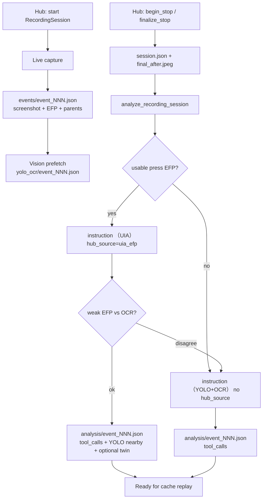
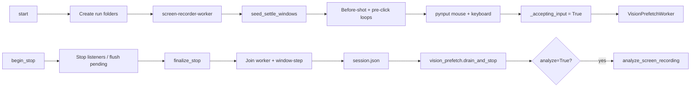
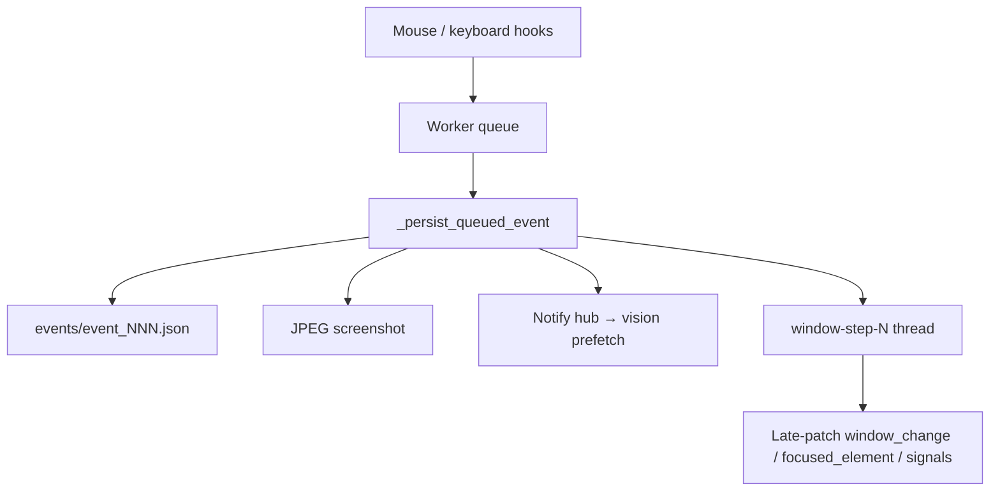
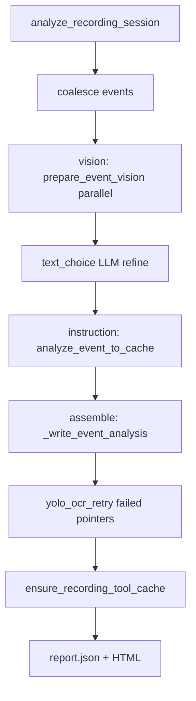
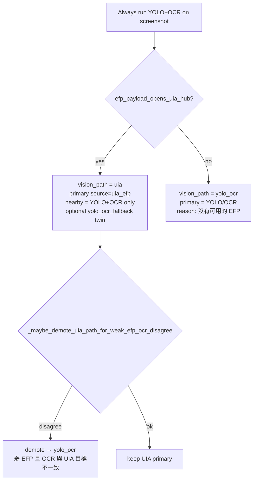
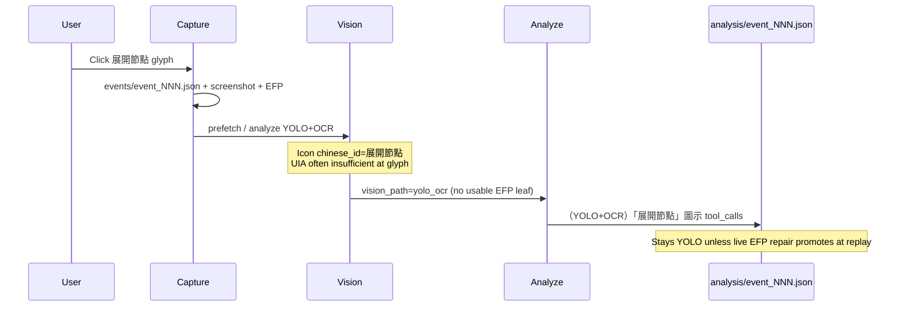

# Recording pipeline

How a live session becomes durable `events/`, `yolo_ocr/`, and `analysis/` artifacts.

For low-level capture threads (before-shot, settle UIA, idle hover), see [`RECORDING_LOOPS.md`](../RECORDING_LOOPS.md).

Interactive overview (open in a browser; switch Replay / Recording): [`uia-replay-path.html`](uia-replay-path.html).

## Overview

## Stages

| # | Stage | Entry | Main outputs |
|---|--------|--------|--------------|
| 1 | Start session | `app_main_hub` → `RecordingSession.start` | `events/`, `screenshots/`, `yolo_ocr/` |
| 2 | Live capture | mouse/keyboard → worker queue | `events/event_NNN.json` |
| 3 | Vision prefetch | `VisionPrefetchWorker` | `yolo_ocr/event_NNN.json` (often) |
| 4 | Stop / finalize | `begin_stop` → `finalize_stop` | `session.json`, `final_after.jpeg` |
| 5 | Analyze | `analyze_recording_session` | `analysis/event_NNN.json`, `report.json` |

---

## 1. Session start / stop

| Role | Path |
|------|------|
| Hub | `app_main_hub.py` → `_start_recording` / `_stop_recording` |
| Capture | `src/recorder/capture.py` → `RecordingSession` |
| Analyze entry | `main.py` → `analyze_screen_recording` → `orchestrator.analyze_recording_session` |

Press-time FindAll caches are removed (Phase 2); new recordings never attach a budgeted window FindAll snapshot.

---

## 2. Event capture

A pointer event typically stores:

- `index`, `kind`, `cursor_xy`, button / modifiers / click count
- `screenshot_path`, `monitor_index`, `monitor_offset`, `click_window`
- `element_from_point` — Name / Value / bbox / control_type / **`parents`** (ControlView ancestor chain; worker probe, not the mouse hook)
- **no** `uia_snapshot` / `end_uia_snapshot` on new recordings (fields absent; FindAll walks are gone)
- later patches: `window_change`, `focused_element`, drag `end_*`

Idle vs live EFP: `_resolve_press_element_from_point` may prefer the pre-click idle latch when live Name/Value diverges after press (`idle_fallback` / `idle_only` / `live` in `record.log`).

Key APIs: `RecordingSession._persist_queued_event`, `models.write_event_json`, `element_from_point_name_value`.

---

## 3. Analyze session

### Per-event vision (`prepare_event_vision`)

1. Caption-button shortcut → skip vision  
2. Else cache hit (`try_rebuild_vision_from_cache`)  
3. Else `build_vision_context` → YOLO+OCR → `build_vision_context_at_point`

### Per-event instruction (`analyze_event_to_cache`)

Deterministic first (text / keys / window / caption / click|drag|scroll from vision).  
LLM only if those fail and pointer vision did not soft-fail.  
Prefix via `_prefix_instruction_vision_mode`: `（UIA）` or `（YOLO+OCR）`.

---

## 4. UIA vs YOLO at analyze time

Core decision in `_detect_recording_mouse_targets` (`vision_context.py`):

- **Sole UIA hub:** press-time EFP (`source` / `hub_source=uia_efp`). Opens when EFP is a usable labeled leaf, `data_item`, or WinForms scrollbar thumb (`Position` + bbox) — **no FindAll hub**; never `hub_source=findall`.
- **Nearby / `landmark_geometry`:** YOLO+OCR peers only (`existing=[]` when injecting the EFP peer).
- **Weak-EFP demotion:** after a UIA path is chosen, OCR that clearly disagrees with the EFP hub can demote to `vision_path=yolo_ocr`.
- Compile stamps `hub_source=uia_efp` only for EFP primaries; emits EFP `name` / `value` / `parents` (never singular `parent` / `hub_parent`).

Chrome icons such as `展開節點` are in `_CONTROL_CHROME_ICON_IDS` and can rank as the primary click target over overlapping OCR text when EFP is unusable.

Disk: `yolo_ocr/event_NNN.json` (candidates, `vision_path`, optional nested fallback, debug layers).

---

## 5. Analysis JSON + YOLO twin

`_write_event_analysis` writes `analysis/event_NNN.json`:

| Field | Meaning |
|-------|---------|
| `instruction` | Hub script line (`（UIA）` or `（YOLO+OCR）`) |
| `tool_calls` | From `compile_tool_calls` (`move_mouse` + `click`, etc.) |
| `yolo_ocr_fallback` | Twin `{instruction, tool_calls}` when UIA primary kept YOLO detections |
| `vision` | Thin: `used_vision`, `candidate_text` (full candidates stay in `yolo_ocr/`) |
| `window_verify` | Foreground / appear-disappear checks |
| `landmark_geometry` | Inside `move_mouse` args when nearby / offset / scroll-hover |

`move_mouse` args also carry sole `hub_source=uia_efp` (when EFP hub), recorded EFP `name` / `value` / `parents`, and `click_window`. Pure YOLO steps omit `hub_source`.

Twin build: `build_yolo_ocr_fallback_from_vision` when `vision["yolo_ocr_fallback_vision"]` exists.

> **Note:** Budgeted window FindAll walks are gone. Same-run **EFP-based** YOLO→UIA repair can still arm at cache replay for pure `vision_path=yolo_ocr` steps (OCR confirm + live ElementFromPoint). Twins remain for soft-miss select. See [`replay-flow.md`](replay-flow.md).

---

## 6. Example: tree expand glyph

---

## Key files

| Concern | File | Functions |
|---------|------|-----------|
| Start/stop | `src/recorder/capture.py` | `RecordingSession.start`, `begin_stop`, `finalize_stop` |
| Hub | `app_main_hub.py` | `_start_recording`, `_stop_recording` |
| Analyze | `src/recorder/orchestrator.py` | `analyze_recording_session`, `prepare_event_vision`, `_write_event_analysis` |
| Instructions | `src/recorder/analyze.py` | `analyze_event_to_cache`, `instruction_for_click` |
| UIA vs YOLO | `src/recorder/vision_context.py` | `_detect_recording_mouse_targets`, `_press_efp_opens_uia_hub`, `_maybe_demote_uia_path_for_weak_efp_ocr_disagree` |
| EFP probe | `src/recorder/uia_input_boxes.py` | `element_from_point_name_value`, `efp_payload_opens_uia_hub` |
| Tool compile | `src/recorder/compile_tool_calls.py` | `compile_tool_calls`, `_move_mouse_call`, `_hub_source_from_vision` |
| Twin / repair | `src/recorder/uia_replay_repair.py` | `build_yolo_ocr_fallback_from_vision`, `yolo_ocr_fallback_slots`, `replay_repair_slots` |
| Geometry | `src/recorder/landmark_geometry.py` | `build_landmark_geometry` |

## Disk artifacts

| Path | When |
|------|------|
| `events/event_NNN.json` | Capture persist (+ window-step patches) |
| `signals/event_NNN_*.json` | Peeled from event debug |
| `screenshots/*`, `final_after.jpeg` | Capture / stop |
| `yolo_ocr/event_NNN.json` | Prefetch and/or analyze vision |
| `analysis/event_NNN.json` | Analyze assemble |
| `session.json`, `report.json`, `record.log` | Stop / analyze |
