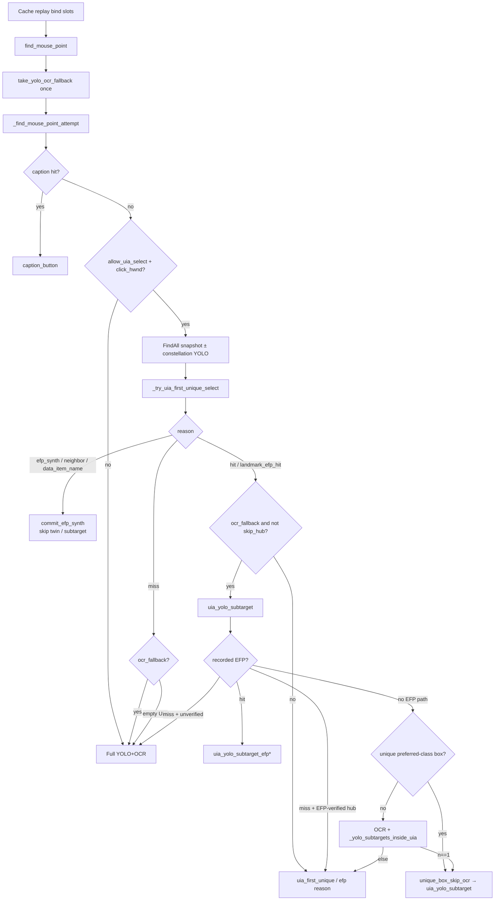
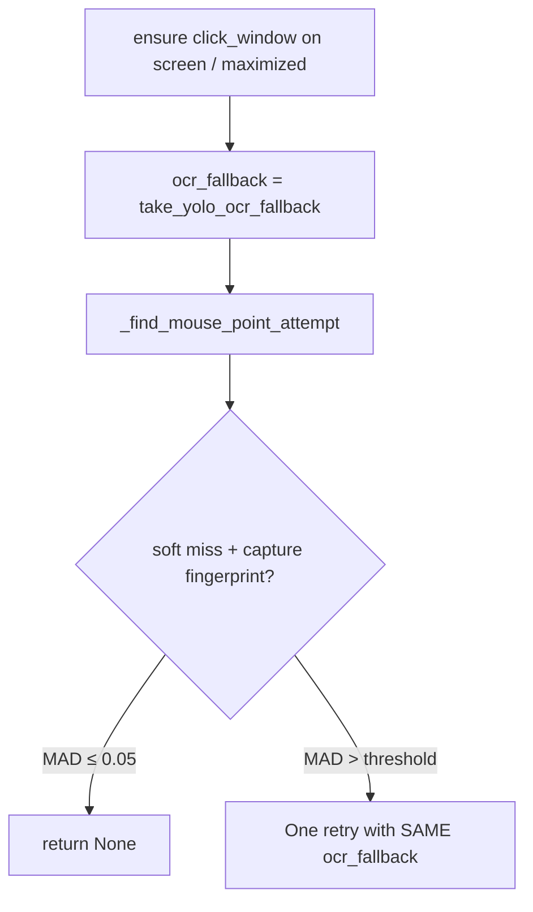
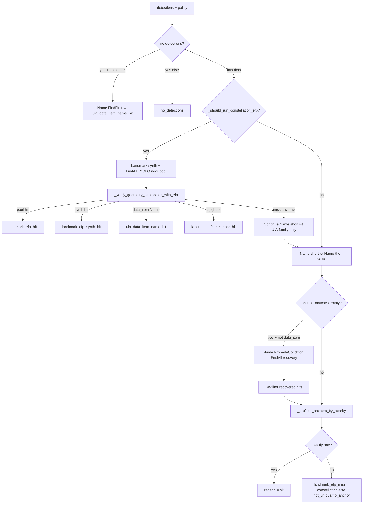
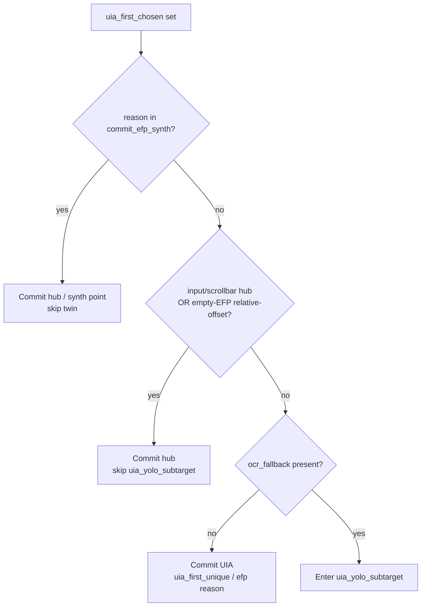
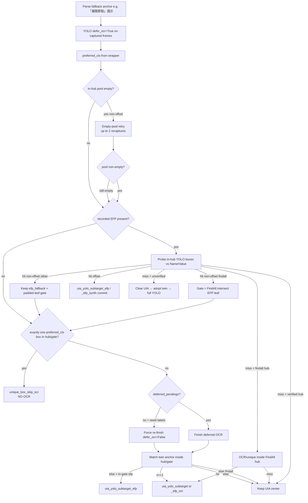
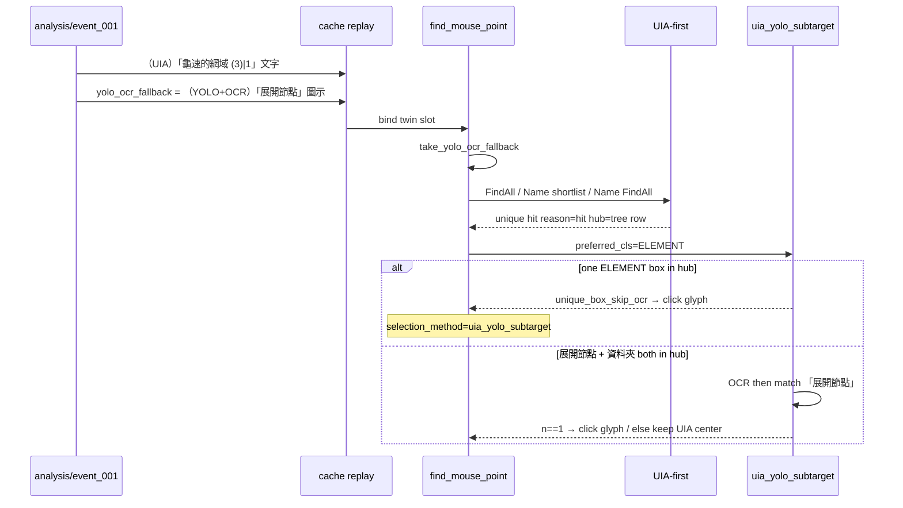
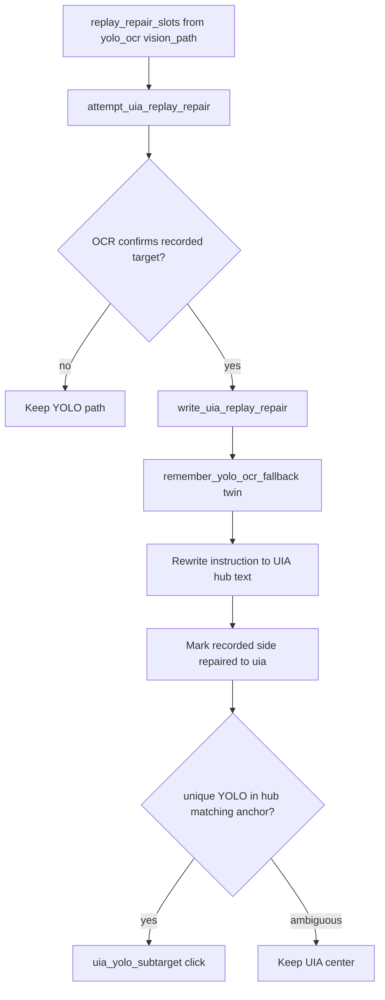

# Replay / `move_mouse` selection pipeline

How cache replay turns an `analysis/event_NNN.json` step into a screen click — especially UIA-first, Name FindAll recovery, and `uia_yolo_subtarget` for repaired icon steps.

Recording side (how twins are prepared): [`recording-flow.md`](recording-flow.md).

## Overview

## Stages

| # | Stage | Where |
|---|--------|--------|
| 0 | Bind repair + YOLO twin slots | `src/brain/module.py` |
| 1 | `find_mouse_point` entry | `cua_mcp/select_mouse_target.py` |
| 2 | Caption / parse / UIA gate | `_find_mouse_point_attempt` |
| 3 | UIA-first unique select | `_try_uia_first_unique_select` |
| 4 | Commit vs subtarget vs YOLO twin | after UIA-first |
| 5 | `uia_yolo_subtarget` | in-hub YOLO (± OCR) |
| 6 | Full YOLO+OCR fallthrough | twin or pure YOLO mode |
| 7 | Final `selection_method` | commit point |

---

## 0. Cache replay arms slots

When executing cached tool calls with `SCRIPT_PATH` set (`src/brain/module.py`):

1. Resolve `recording_dir` + `event_index` for the current script step.
2. `replay_repair_slots(...)` → `bind_uia_replay_repairs` (optional live repair for remaining `（YOLO+OCR）` steps).
3. `yolo_ocr_fallback_slots(...)` → `bind_yolo_ocr_fallbacks`.
4. Both wrap the tool loop under `require_similarity_match()`.

### YOLO twin slot

| Piece | Behavior |
|-------|----------|
| `YoloOcrMoveFallback` | `instruction`, `nearby_objects`, `landmark_geometry`, `hub_source` |
| `yolo_ocr_fallback_slots` | One slot per `move_mouse`; two per `drag` (`start_*` / `destination_*`) |
| `take_yolo_ocr_fallback` | `slots.pop(0)` — once per `find_mouse_point` |

Twin is stored on analysis JSON via `remember_yolo_ocr_fallback` / `build_yolo_ocr_fallback_from_vision` when a UIA hub must keep the original YOLO sentence for soft-miss / subtarget.

---

## 1. `find_mouse_point` entry

---

## 2. Attempt: caption, parse, UIA gate

1. **Caption shortcut** — caption role + `click_window` → `caption_button` (no YOLO/OCR).
2. **Parse** — `vision_mode`, `anchor_text`, `control_type`, recorded EFP, `hub_source`.
   - `allow_uia_select = vision_mode != "yolo_ocr"`
   - `filter_by_control_type = vision_mode == "uia"`
3. **Repair arm** — if similarity required and mode is `yolo_ocr`, `take_uia_replay_repair()`.
4. **UIA-first gate** — enter when `allow_uia_select` ∧ `refine_with_uia` ∧ `click_window` hwnd:
   - Grab monitors
   - FindAll → `_uia_only_detections_for_click_window`
   - Optionally merge deferred YOLO TEXT/ELEMENT for constellation EFP
   - `_try_uia_first_unique_select`
   - On miss: retry FindAll once; still miss → adopt `ocr_fallback` fields or force empty-UIA → YOLO

---

## 3. UIA-first: `_try_uia_first_unique_select`

### When constellation EFP runs

| `hub_source` | Constellation? |
|--------------|----------------|
| `uia_efp` | Yes (when landmark + recorded EFP present) |
| `findall` | No — Name shortlist only |
| missing (legacy) | Soft-agree EFP↔hub ≥ 0.5 |

Constellation EFP miss (labeled or input/scrollbar) always continues into Name shortlist / Name FindAll. That continue path keeps **UIA-family** sources only (`uia`, `uia_efp`, empty) so deferred YOLO/OCR boxes merged for near-synth cannot unique-hit as a FindAll hub. If Name also fails, the reason stays `landmark_efp_miss` so the YOLO twin path still runs.

### Name FindAll last fallback

If the budgeted snapshot walk truncated the target, a targeted Name PropertyCondition FindAll under the click hwnd recovers candidates. A **unique** recovery still returns `reason="hit"` — same as a normal snapshot hit — so it **still enters** `uia_yolo_subtarget` when a twin is present. This recovery also runs after a constellation EFP miss when press-time FindAll stamped `hub_source=uia_efp` but live Name FindAll can still expose the leaf.

### Reason strings

`hit`, `no_detections`, `no_anchor`, `not_unique`, `landmark_efp_hit`, `landmark_efp_synth_hit`, `landmark_efp_neighbor_hit`, `landmark_efp_miss`, `uia_data_item_name_hit`

---

## 4. After UIA-first: commit vs subtarget

`commit_efp_synth` reasons (twin skipped):

- `landmark_efp_synth_hit`
- `landmark_efp_neighbor_hit`
- `uia_data_item_name_hit`

`landmark_efp_hit` is **not** in that set — with a twin it still enters subtarget (unless hub skip). Soft-miss keep uses `_EFP_VERIFIED_UIA_FIRST_REASONS`, which **includes** `landmark_efp_hit`.

---

## 5. `uia_yolo_subtarget`

**When:** UIA-first hit **and** `ocr_fallback` present **and** not input/scrollbar **and** not `commit_efp_synth` **and** not empty-EFP relative-offset.

Non-offset recorded-EFP **hit** is a **row gate**, not the click chooser:

- Build a padded leaf rect (12px; fall back to padded UIA-first bbox).
- **`hub_source=findall`:** gate = **intersection(FindAll hub, EFP leaf)** (optional 12px pad on the intersection only). Never substitute `pad(FindAll)` alone. Empty intersection → no EFP gate; clear pane fallback; OCR/unique inside FindAll hub.
- Keep EFP pool fallback only when its center lies inside that gate (drops oversized parent panes like `CoreInput`).
- Still run unique-box / OCR for the twin anchor **inside that gate**.
- Unique OCR/icon match → `uia_yolo_subtarget_efp_ocr`.
- Not unique → after OCR has finished, fall back to the Name/Value pool det (`uia_yolo_subtarget_efp`) when still in-gate; on findall hubs prefer **FindAll center** over an out-of-hub pane det.
- **Ensure OCR** before EFP `ocr_miss` when unique-box is impossible and preferred twin needs labels (finish deferred pending, or force re-finish when pending is missing).
- Offset / synth empty-space clicks still commit EFP immediately.

### Empty in-hub YOLO retry (paint lag)

When the preferred-class in-hub pool is **empty** after the first deferred YOLO (and the click is not a relative-offset empty-space target), wait ~300 ms and re-grab / re-run deferred YOLO up to **2** extra times (`EMPTY_IN_HUB_YOLO_MAX_EXTRA`). Stop early when boxes appear. This is **not** the post-failure MAD `ui_change_retry` (that path only re-runs when the click-window ROI changed a lot).

If the pool stays empty, continue into soft-miss / OCR-inside as below — FindAll hubs keep the UIA leaf instead of clearing into twin fallthrough.

### Soft-miss: keep FindAll

`_keep_uia_first_on_subtarget_efp_soft_miss` is true for EFP-verified UIA-first reasons **and** for `hub_source=findall`. FindAll soft-miss keeps the Name leaf and still tries OCR/unique **inside** that hub; if OCR also misses, commit the FindAll center. Only non-FindAll, non-verified hubs clear into full OCR-twin YOLO fallthrough.

### In-hub YOLO pool

`_subtarget_yolo_boxes_in_hub` is the single consumer API for in-hub/gate geometry:

- **Pending-first** (`_ocr_pending` / `_MouseOcrPending`) — OCR-capable work units.
- **`debug_layers` fallback** — geometry sidecar only (no BGR); used when pending was lost.

Counting (unique-box / EFP pool / multi-box) and finish decisions must use this pool so they cannot diverge. When the pool has **2+** preferred-class boxes and pending is empty, re-finish the same capture with `defer_ocr=False` so twin OCR (e.g. `展開節點`) still runs — do not choose unlabeled boxes + row-EFP alone.

### Preferred class (`_uia_yolo_subtarget_preferred_class`)

| Fallback wrapper | Class |
|------------------|--------|
| `…文字` / `超連結` | TEXT |
| `…圖示` / `元素` | ELEMENT |
| ambiguous (e.g. bare 輸入欄) | `None` → cannot unique-skip |

One in-hub (or in-gate) box of that class → skip OCR. Multiple → OCR (deferred finish, or forced re-finish if pending missing), then match the fallback anchor (icon id / text similarity) among those boxes.

---

## 6. Full YOLO+OCR fallthrough

Triggers:

- UIA-first miss after retry + twin → rewrite select fields from twin, then YOLO+OCR
- Empty UIA snapshot, no twin → force `vision_mode=yolo_ocr`
- Subtarget EFP soft-miss cleared UIA hub (non-FindAll, non-verified) → twin already adopted
- Pure `vision_mode=yolo_ocr` from the start (`allow_uia_select=False`)

May still run same-run `attempt_uia_replay_repair` for a remaining `（YOLO+OCR）` step and promote a unique in-repair-box YOLO leaf → `uia_yolo_subtarget`.

---

## 7. Final `selection_method`

When `uia_first_chosen` is set (commit path):

| Priority | Condition | `selection_method` |
|----------|-----------|--------------------|
| 1 | `uia_yolo_subtarget_chosen` | `uia_yolo_subtarget` / `_efp` / `_efp_synth` |
| 2 | EFP-verified reason | `landmark_efp_hit`, `landmark_efp_synth_hit`, `landmark_efp_neighbor_hit`, `uia_data_item_name_hit` |
| 3 | else (e..g. plain `hit`) | `uia_first_unique` |

Point: `(cx + offset_dx, cy + offset_dy)` unless char-target / scrollbar percent overrides.

Other methods elsewhere: `caption_button`, `uia_replay_repair`, `landmark_unique`, `visual_one_pass_fallback`, `gemma_roi*`, `anchor_efp_pick`, …

---

## Example: 「龜速的網域 (3)|1」 + twin 「展開節點」

Name FindAll recovery of the same unique hub still returns `hit` and still runs this subtarget path. Excel `uia_data_item_name_hit` does **not** — it commits the Name leaf and skips the twin.

### Soft EFP after empty UIA + icon twin

When UIA-first returns an empty snapshot and the twin rewrites the anchor to e.g. `「展開節點」圖示`, geometry EFP may still Name/Value-match the tree row under the glyph. Commit **keeps the ELEMENT/icon pool box** (click the glyph); leaf-bbox snap remains only for coarse TEXT/INPUT/DataItem hubs (Excel Value cells / wide rows).

---

## Same-run UIA replay repair (YOLO → UIA)

For steps that are still `（YOLO+OCR）` at replay (e.g. icon click recorded as YOLO):

---

## Key files

| Path | Symbols |
|------|---------|
| `src/brain/module.py` | Cache replay bind of repair + fallback slots |
| `src/recorder/uia_replay_repair.py` | `YoloOcrMoveFallback`, `bind`/`take_yolo_ocr_fallback*`, `yolo_ocr_fallback_slots`, `attempt_uia_replay_repair`, `write_uia_replay_repair` |
| `cua_mcp/select_mouse_target.py` | `find_mouse_point`, `_find_mouse_point_attempt`, `_try_uia_first_unique_select`, `_uia_yolo_subtarget_preferred_class`, `_unique_yolo_box_inside_uia`, `_yolo_subtargets_inside_uia` |
| `tests/test_select_mouse_target.py` | Contract tests for reasons / methods |
