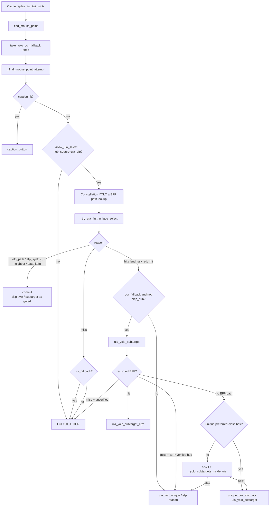
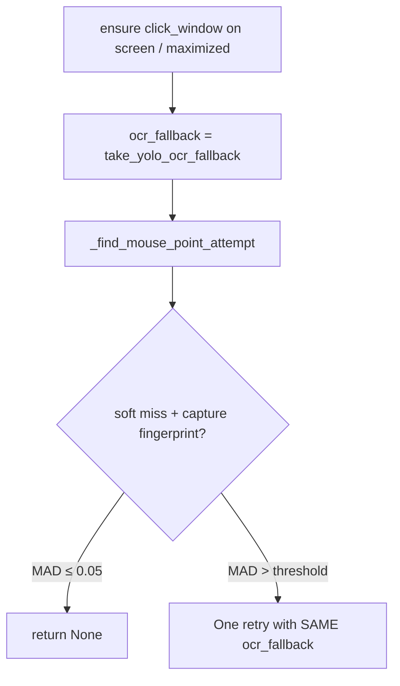
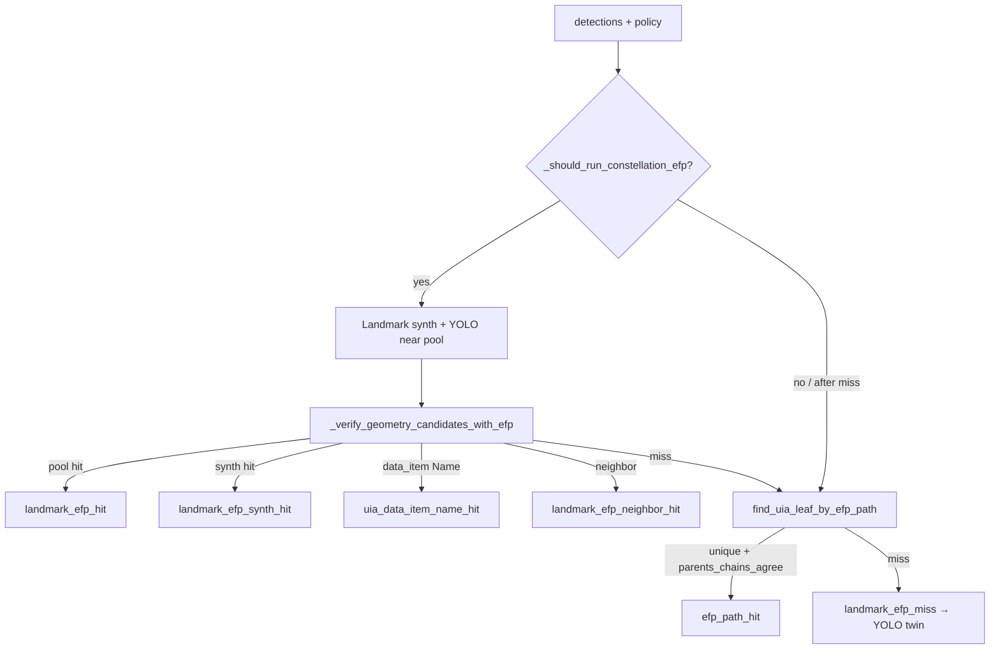
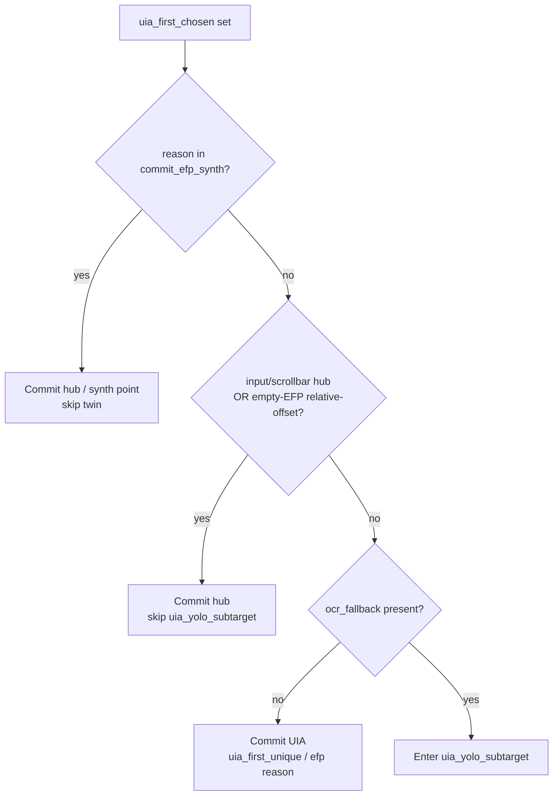
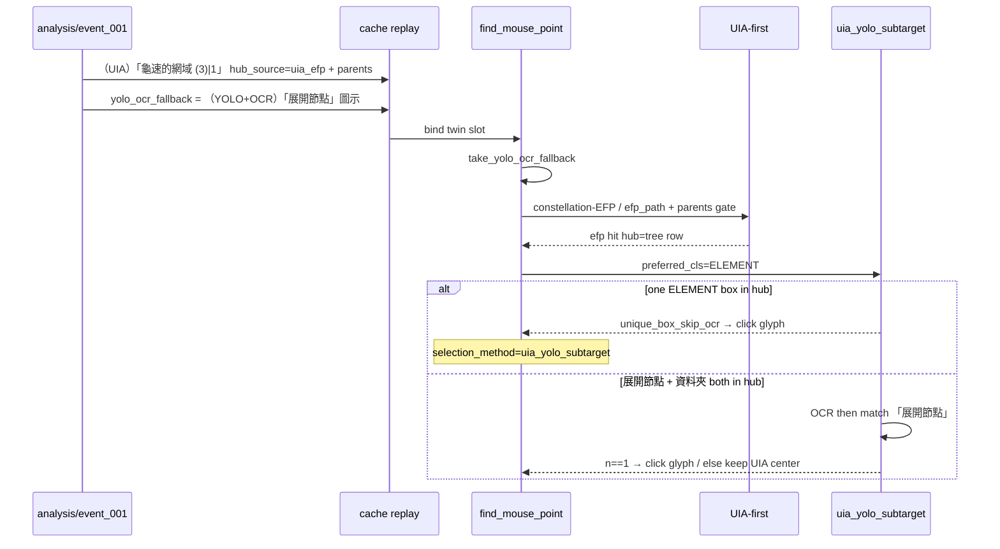

# Replay / `move_mouse` selection pipeline

How cache replay turns an `analysis/event_NNN.json` step into a screen click — especially UIA-first via constellation-EFP + ancestor-scoped path lookup, and YOLO soft-miss.

Recording side (how twins are prepared): [`recording-flow.md`](recording-flow.md).

Interactive overview (open in a browser; switch Replay / Recording): [`uia-replay-path.html`](uia-replay-path.html).

## Overview

## Stages

| # | Stage | Where |
|---|--------|--------|
| 0 | Bind YOLO twin slots (repair slots no-op) | `src/brain/module.py` |
| 1 | `find_mouse_point` entry | `cua_mcp/select_mouse_target.py` |
| 2 | Caption / parse / UIA gate | `_find_mouse_point_attempt` |
| 3 | UIA-first unique select | `_try_uia_first_unique_select` |
| 4 | Commit vs subtarget vs YOLO twin | after UIA-first |
| 5 | `uia_yolo_subtarget` | in-hub YOLO (± OCR) |
| 6 | Full YOLO+OCR fallthrough | twin or pure YOLO mode |
| 7 | Final `selection_method` | commit point |

---

## 0. Cache replay arms slots

When executing cached tool calls with `SCRIPT_PATH` set (`src/brain/module.py`):

1. Resolve `recording_dir` + `event_index` for the current script step.
2. `replay_repair_slots(...)` → always empty for new format (live FindAll YOLO→UIA repair **disabled**).
3. `yolo_ocr_fallback_slots(...)` → `bind_yolo_ocr_fallbacks`.
4. Twin bind wraps the tool loop under `require_similarity_match()`.

### YOLO twin slot

| Piece | Behavior |
|-------|----------|
| `YoloOcrMoveFallback` | `instruction`, `nearby_objects`, `landmark_geometry`, `hub_source` (`uia_efp` only when set) |
| `yolo_ocr_fallback_slots` | One slot per `move_mouse`; two per `drag` (`start_*` / `destination_*`) |
| `take_yolo_ocr_fallback` | `slots.pop(0)` — once per `find_mouse_point` |

Twin is stored on analysis JSON via `remember_yolo_ocr_fallback` / `build_yolo_ocr_fallback_from_vision` when a UIA hub must keep the original YOLO sentence for soft-miss / subtarget.

---

## 1. `find_mouse_point` entry

---

## 2. Attempt: caption, parse, UIA gate

1. **Caption shortcut** — caption role + `click_window` → `caption_button` (no YOLO/OCR).
2. **Parse** — `vision_mode`, `anchor_text`, `control_type`, recorded EFP `name`/`value`/`parents`, `hub_source`.
   - `allow_uia_select = vision_mode != "yolo_ocr"`
   - `filter_by_control_type = vision_mode == "uia"`
   - `_normalize_hub_source` keeps only `uia_efp` (legacy `findall` dropped).
3. **Repair arm** — FindAll YOLO→UIA repair walks are **not** armed (`repair_yolo=False`).
4. **UIA-first gate** — enter when `allow_uia_select` ∧ `refine_with_uia` ∧ `click_window` hwnd ∧ (`hub_source=uia_efp` or recorded EFP identity):
   - Grab monitors
   - Optional constellation YOLO TEXT/ELEMENT for landmark geometry
   - `_try_uia_first_unique_select` (no budgeted window FindAll walk)
   - On miss → adopt `ocr_fallback` fields or force empty-UIA → YOLO

---

## 3. UIA-first: `_try_uia_first_unique_select`

Single UIA path for `hub_source=uia_efp` (ancestor-path format):

### When constellation EFP runs

| `hub_source` | Constellation? |
|--------------|----------------|
| `uia_efp` | Yes (when landmark + recorded EFP present) |
| missing / other | No |

Before commit, live `parents` must agree with the recorded chain (`parents_chains_agree`).

### Reason strings

`efp_path_hit`, `landmark_efp_hit`, `landmark_efp_synth_hit`, `landmark_efp_neighbor_hit`, `landmark_efp_miss`, `uia_data_item_name_hit`, `parents_chain_miss`, `no_detections`, `no_anchor`, `not_unique`

---

## 4. After UIA-first: commit vs subtarget

`commit_efp_synth` reasons (twin skipped):

- `landmark_efp_synth_hit`
- `landmark_efp_neighbor_hit`
- `uia_data_item_name_hit`
- `efp_path_hit` (when gated)

---

## 5. `uia_yolo_subtarget`

**When:** UIA-first hit **and** `ocr_fallback` present **and** not input/scrollbar **and** not `commit_efp_synth` **and** not empty-EFP relative-offset.

Non-offset recorded-EFP **hit** is a **row gate**, not the click chooser:

- Build a padded leaf rect (12px; fall back to padded UIA-first bbox).
- Keep EFP pool fallback only when its center lies inside that gate.
- Still run unique-box / OCR for the twin anchor **inside that gate**.
- Unique OCR/icon match → `uia_yolo_subtarget_efp_ocr`.

### Soft-miss keep

`_keep_uia_first_on_subtarget_efp_soft_miss` is true for EFP-verified UIA-first reasons only. Legacy `hub_source=findall` is **not** a soft-miss keep path.

### Preferred class (`_uia_yolo_subtarget_preferred_class`)

| Fallback wrapper | Class |
|------------------|--------|
| `…文字` / `超連結` | TEXT |
| `…圖示` / `元素` | ELEMENT |
| ambiguous (e.g. bare 輸入欄) | `None` → cannot unique-skip |

---

## 6. Full YOLO+OCR fallthrough

Triggers:

- UIA-first miss + twin → rewrite select fields from twin, then YOLO+OCR
- No UIA hub (`hub_source` omitted) → pure `vision_mode=yolo_ocr`
- Subtarget EFP soft-miss cleared unverified hub → twin already adopted

Live FindAll repair promotion is **not** used on this path.

---

## 7. Final `selection_method`

When `uia_first_chosen` is set (commit path):

| Priority | Condition | `selection_method` |
|----------|-----------|--------------------|
| 1 | `uia_yolo_subtarget_chosen` | `uia_yolo_subtarget` / `_efp` / `_efp_synth` |
| 2 | EFP-verified reason | `landmark_efp_hit`, `landmark_efp_synth_hit`, `landmark_efp_neighbor_hit`, `uia_data_item_name_hit`, `efp_path_hit` |
| 3 | else | `uia_first_unique` |

Point: `(cx + offset_dx, cy + offset_dy)` unless char-target / scrollbar percent overrides.

Other methods elsewhere: `caption_button`, `landmark_unique`, `visual_one_pass_fallback`, `gemma_roi*`, `anchor_efp_pick`, …

---

## Example: 「龜速的網域 (3)|1」 + twin 「展開節點」

### `uia_data_item_name_hit` Name vs Value

Targeted Name lookup (not a budgeted window walk):

- **Empty recorded Value** (Excel-style unique Names such as `N15`): Name FindFirst → commit.
- **Non-empty recorded Value** (column-named grid cells): Name+DataItem FindAll, then **post-filter** live ValuePattern to the recorded Value. Commit only when exactly one Value match remains.

---

## Same-run UIA replay repair (disabled)

Live budgeted FindAll that promoted `（YOLO+OCR）` → UIA during cache replay is **disabled** for new format. Usable UIA hubs already stamp `hub_source=uia_efp` + `parents` at analysis; pure YOLO steps stay on the twin / YOLO path. `choose_uia_replay_repair*` / `write_uia_replay_repair` remain for tests only.

---

## Key files

| Path | Symbols |
|------|---------|
| `src/brain/module.py` | Cache replay bind of fallback slots |
| `src/recorder/uia_replay_repair.py` | `YoloOcrMoveFallback`, twin bind/take, disabled repair slots |
| `src/recorder/uia_input_boxes.py` | `find_uia_leaf_by_efp_path`, `parents_chains_agree`, `parents_chain_at_point` |
| `cua_mcp/select_mouse_target.py` | `find_mouse_point`, `_try_uia_first_unique_select`, constellation + path lookup |
| `tests/test_select_mouse_target.py` | Contract tests for reasons / methods |
| `tests/test_landmark_geometry_efp.py` | Constellation / parents / soft-miss gates |
